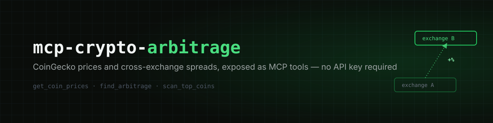

<p align="center">
  
</p>

<p align="center">
  <a href="https://github.com/arminasbek/mcp-crypto-arbitrage/blob/main/LICENSE"></a>
  = 18">
  
  
</p>

An [MCP](https://modelcontextprotocol.io) server that exposes [CoinGecko](https://www.coingecko.com) crypto market data as tools — get spot prices and find cross-exchange arbitrage spreads without ever needing an API key.

## Tools

| Tool | What it does |
|------|---------------|
| `get_coin_prices` | Current USD prices for one or more coins by CoinGecko ID |
| `find_arbitrage` | Widest cross-exchange USD/USDT price spread for one coin, above a minimum percentage |
| `scan_top_coins` | Scan the top N coins by market cap for arbitrage spreads above a threshold |

## Prerequisites

- Node.js 18+
- Nothing else — CoinGecko's public API works with no key. Optionally set `COINGECKO_API_KEY` (free [Demo key](https://www.coingecko.com/en/api/pricing)) for a higher rate limit (100 calls/min vs the public tier's much lower limit)

## Installation

### Quick install

The package is published on npm, so these register it in one step — no cloning or building required:

**Claude Code:**
```bash
claude mcp add crypto-arbitrage -- npx -y mcp-crypto-arbitrage
```

**Codex CLI:**
```bash
codex mcp add crypto-arbitrage -- npx -y mcp-crypto-arbitrage
```

### Manual config (any stdio MCP client)

Most clients that support stdio MCP servers (Claude Desktop, Cursor, Windsurf, etc.) use this same config shape — add it to whichever config file your client expects:

```json
{
  "mcpServers": {
    "crypto-arbitrage": {
      "command": "node",
      "args": ["/absolute/path/to/mcp-crypto-arbitrage/dist/index.js"]
    }
  }
}
```

Add `COINGECKO_API_KEY` under `env` if you have one.

Restart your client, then try asking:

> "What's the price of bitcoin and ethereum right now?"
>
> "Is there an arbitrage opportunity on solana above 0.5%?"
>
> "Scan the top 10 coins for cross-exchange spreads"

## How it works

```
MCP client (Claude, Inspector, ...)
        │  stdio, JSON-RPC
        ▼
  McpServer (src/server.ts)
        │
        ▼
  tools/*.ts     — one file per tool: Zod schema + handler, formats the reply
        │
        ▼
  endpoints/*.ts — one file per CoinGecko endpoint: typed request + response
        │
        ▼
  apiClient.ts   — optional demo-key header, CoinGecko error/rate-limit parsing
        │
        ▼
  client.ts      — generic fetch wrapper, timeout, HTTP error handling
        │
        ▼
  CoinGecko REST API
```

Each layer knows nothing about the one above it. `client.ts` doesn't know CoinGecko exists; `endpoints/` doesn't know MCP exists. Adding a new tool means one new file in `endpoints/`, one new file in `tools/`, one line in `tools/index.ts` — nothing else changes.

Tool arguments are validated with [Zod](https://zod.dev) before any handler runs — a malformed request never reaches the API.

`find_arbitrage` and `scan_top_coins` compare only USD/USDT-quoted markets from CoinGecko's `/coins/{id}/tickers` endpoint — the widest gap between the lowest and highest last-traded price across those markets is reported as the spread. This is raw market-data spread, not a tradeable guarantee: it ignores withdrawal/deposit friction, exchange fees, and execution slippage.

## Development

```bash
git clone https://github.com/arminasbek/mcp-crypto-arbitrage.git
cd mcp-crypto-arbitrage
npm install
npm run build   # compile TypeScript
npm run lint     # check formatting + lint rules
npm run check    # lint + format + fix, in place
```

Test locally with the [MCP Inspector](https://github.com/modelcontextprotocol/inspector):

```bash
npx @modelcontextprotocol/inspector --cli node dist/index.js --method tools/call --tool-name get_coin_prices --tool-arg coins=bitcoin,ethereum
```

## License

MIT
